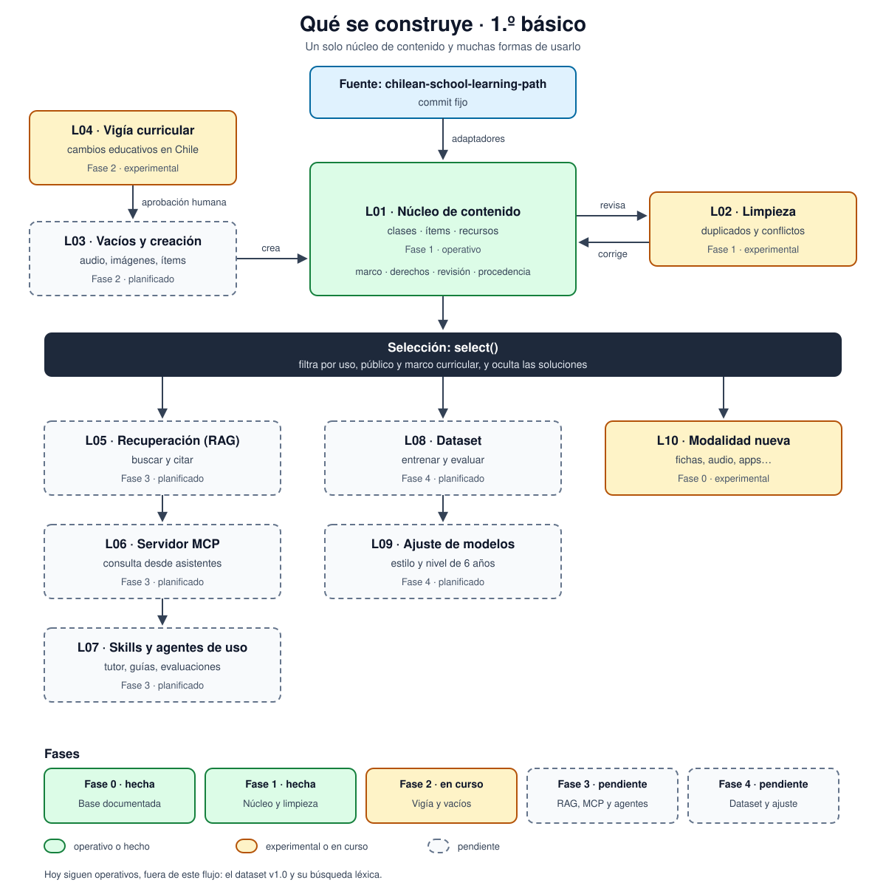
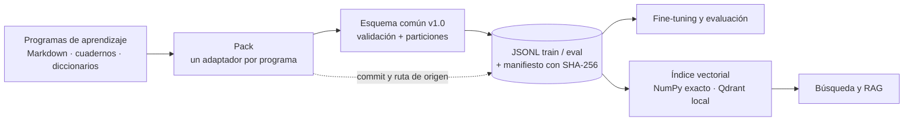

<div align="center">

# 📚 learning-path-datasets

## Datos de aprendizaje listos para entrenar y recuperar: JSONL con procedencia, licencia y evaluación, más una base vectorial

[](https://github.com/vladimiracunadev-create/learning-path-datasets/actions/workflows/ci.yml)
[](https://github.com/vladimiracunadev-create/learning-path-datasets/actions/workflows/security.yml)
[](https://www.python.org/)
[](LICENSE)
[](DATA-LICENSE.md)

</div>

**learning-path-datasets** convierte programas de aprendizaje estructurados en datasets **multiconocimiento** para entrenar o evaluar modelos: cada ejemplo es una línea JSONL con su pregunta, respuesta, razón, dificultad, **procedencia** (repositorio, versión y archivo), **licencia**, **estado de revisión** y **partición** de entrenamiento o evaluación. Sobre esos mismos datos mantiene una **base vectorial local** para búsqueda y recuperación (RAG).

[Plan de 1.º básico](docs/PLAN_1_BASICO.md) · [Método y decisiones](docs/METODO.md) · [Líneas](docs/lineas/README.md) · [Núcleo](docs/CORE_CONTRACT.md) · [Esquema](docs/DATASET_SCHEMA.md) · [Arquitectura](docs/ARCHITECTURE.md) · [Base vectorial](docs/VECTOR_STORE.md) · [Tarjeta del dataset escolar](docs/DATASET_CARD_escolar-chile.md) · [Cómo sumar un programa](docs/ADDING_A_PACK.md) · [Conocimiento puro](docs/KNOWLEDGE_STANDARD.md) · [Skills y agentes](docs/SKILLS_AND_AGENTS.md) · [Límites y derechos](docs/LIMITS_AND_RIGHTS.md) · [Estado](STATUS.md) · [Hoja de ruta](ROADMAP.md)

> [!IMPORTANT]
> Este repositorio **prepara datos; no entrena modelos ni los distribuye**. El contenido fue elaborado con asistencia de IA y **no tiene revisión humana profesional**. Un dato publicado no es automáticamente correcto, representativo ni apto para cualquier uso. Lee [Límites y derechos](docs/LIMITS_AND_RIGHTS.md) antes de entrenar o redistribuir.

## 🗺️ Qué se construye

El foco actual es **1.º básico**: un solo núcleo de contenido y varias formas de usarlo. Los recuadros con borde discontinuo son **trabajo pendiente**; el dataset v1.0 y su búsqueda léxica, descritos más abajo, ya funcionan fuera de este flujo. Detalle en el [plan](docs/PLAN_1_BASICO.md).



## 🎯 Qué resuelve

Los programas de aprendizaje abiertos tienen explicaciones, ejemplos, ejercicios con respuesta y glosarios, pero viven en Markdown o en código pensado para personas, no para modelos. Aquí se convierten a **un contrato común** que conserva de dónde viene cada ejemplo y bajo qué licencia, y que separa desde el inicio lo que se usa para entrenar de lo que se reserva para evaluar.



## ✅ Estado verificable

Las cifras se generan desde los manifiestos y las comprueba el CI (`python scripts/docs_stats.py --check`).

<!-- STATS:BEGIN -->

| Dataset | Registros | Entrenamiento | Evaluación | Clases (entr. / eval.) | Verificables por cálculo |
|---|---:|---:|---:|---:|---:|
| `escolar-chile` · 1-basico | 16.386 | 14.589 | 1.797 | 498 / 64 | 427 |

**Total publicado:** 16.386 registros en 1 dataset(s).

Tipos en `escolar-chile` · 1-basico: actividad_abierta 562, autoevaluacion 1.686, diccionario_en 214, diccionario_es 355, ejemplo_resuelto 1.131, ejercicio_cerrado 7.868, error_comun 1.124, explicacion 562, vocabulario 2.884.

<!-- STATS:END -->

| Componente | Estado | Evidencia |
|---|---|---|
| Esquema común v1.0 + JSON Schema | `OPERATIVO` | `src/lpdatasets/schema.py`, `schema/record.schema.json`, pruebas |
| Pack `escolar-chile` (1.º básico) | `OPERATIVO` | exportación reproducible desde un commit fijo |
| Pack `markdown-course` (programas en Markdown) | `EXPERIMENTAL` | probado con un programa sintético; no sobre repositorios reales |
| Validación (esquema, ids, SHA-256, particiones) | `OPERATIVO` | `lpdatasets validate` |
| Índice NumPy exacto (coseno) | `OPERATIVO` | `lpdatasets index` / `search` |
| Índice Qdrant local | `OPERATIVO-CON-EXTRA` | extra `qdrant`, prueba de equivalencia con NumPy |
| Embeddings semánticos | `PLANIFICADO` | el embedder por defecto es **léxico**; ver [Base vectorial](docs/VECTOR_STORE.md) |
| Tipos de conocimiento puro (`hecho`, `definicion`, `relacion`…) | `OPERATIVO` | esquema y [estándar](docs/KNOWLEDGE_STANDARD.md) |
| 4 skills y 5 agentes generales para crear y limpiar datasets | `OPERATIVO` | `.claude/`, `scripts/verify_assets.py` y pruebas; estructura verificada, calidad no medida |
| Núcleo de 1.º básico: 887 clases, 16.386 ítems y 1.653 recursos | `OPERATIVO` | `nucleo/`, `lpdatasets core-validate`; contrato [`nucleo-0.1`](docs/CORE_CONTRACT.md), aún experimental |
| Informe de limpieza | `EXPERIMENTAL` | [1.131 hallazgos](docs/informes/limpieza-1-basico.md) con [propuestas por lote](docs/informes/propuestas-limpieza-1-basico.md): 1.066 aceptados, 19 resueltos y 46 pendientes; [correcciones](docs/informes/correcciones-1-basico.md): las 59 aprobadas están aplicadas; [39 dudas decididas](docs/informes/dudas-1-basico.md) |
| Líneas de implementación documentadas | `OPERATIVO` | `scripts/verify_docs.py`; comprueba estructura, no la calidad del texto |
| Otros niveles escolares y otros programas | `PLANIFICADO` | [hoja de ruta](ROADMAP.md) |

## ⚡ Empezar

```bash
git clone https://github.com/vladimiracunadev-create/learning-path-datasets.git
cd learning-path-datasets
python -m venv .venv && . .venv/bin/activate        # en Windows: .venv\Scripts\activate
pip install -e ".[dev]"                              # añade ".[qdrant]" para la base Qdrant

lpdatasets validate                                  # esquema, ids, hashes y particiones
lpdatasets index --out .vector                       # base vectorial local
lpdatasets search "contar objetos de uno en uno" --asignatura matematica -k 3
```

Los datos ya están en `datasets/`. Para regenerarlos hace falta un checkout del programa de origen:

```bash
lpdatasets export --pack escolar-chile --nivel 1-basico \
  --source ../chilean-school-learning-path --out datasets
```

## 🧾 Un registro

```json
{
  "schema": "1.0",
  "id": "escolar-chile:1-basico:ma01-oa-01:c01:ej-recovery-01",
  "pack": "escolar-chile", "dominio": "educacion-escolar",
  "nivel": "1-basico", "asignatura": "matematica", "unidad": "MA01 OA 01", "clase": 1,
  "tipo": "ejercicio_cerrado", "dificultad": 1,
  "entrada": "Cuenta: ● ● ●. ¿Cuántas hay?", "salida": "3",
  "razon": "Se dice uno, dos, tres y el último número es 3.",
  "idioma": "es", "habilidades": [], "verificable": false,
  "fuente": {"repo": "vladimiracunadev-create/chilean-school-learning-path", "commit": "3fd976d…", "ruta": "curriculum/1-basico/matematica/ma01-oa-01.md"},
  "licencia": "CC-BY-NC-SA-4.0", "revision": "ia_asistida_sin_revision_humana", "particion": "train"
}
```

## 🤖 Skills y agentes

Para producir datasets de **conocimiento puro** en cualquier dominio hay cuatro skills (`dataset-conocimiento-extraer`, `dataset-verificar`, `dataset-construir-publicar`, `dataset-pack-nuevo`) y cinco agentes (`extractor-conocimiento`, `verificador-independiente`, `curador-datasets`, `auditor-derechos-datos`, `limpiador-datos`), con la regla de que **quien verifica no es quien escribió**. Se instalan para todos tus proyectos con `python scripts/install_claude_assets.py`. Detalle en [Skills y agentes](docs/SKILLS_AND_AGENTS.md).

## 🧩 Packs

| Pack | Programa de origen | Estado |
|---|---|---|
| `escolar-chile` | [chilean-school-learning-path](https://github.com/vladimiracunadev-create/chilean-school-learning-path) | 1.º básico publicado; los otros once niveles, planificados |
| `markdown-course` | cualquier programa en Markdown | experimental |

Sumar un programa nuevo es escribir un adaptador que emita registros del esquema común: [guía](docs/ADDING_A_PACK.md).

## ⚖️ Licencias

- **Código:** MIT ([`LICENSE`](LICENSE)).
- **Datos publicados:** heredan la licencia del programa de origen. Los de `escolar-chile` son **CC BY-NC-SA 4.0**: requieren atribución, **no permiten uso comercial** sin autorización y exigen compartir igual. Detalle y límites en [`DATA-LICENSE.md`](DATA-LICENSE.md).
- Los textos oficiales de objetivos de aprendizaje **no se copian**: solo se cita su código.

## 🤝 Contribuir y seguridad

[`CONTRIBUTING.md`](CONTRIBUTING.md) · [`SECURITY.md`](SECURITY.md) · [`CODE_OF_CONDUCT.md`](CODE_OF_CONDUCT.md)

Por Vladimir Acuña (`vladimiracunadev-create`). Complementa a [ai-dataset-foundry](https://github.com/vladimiracunadev-create/ai-dataset-foundry), que convierte documentos sueltos en datasets; este repositorio, en cambio, parte de programas de aprendizaje ya estructurados.
