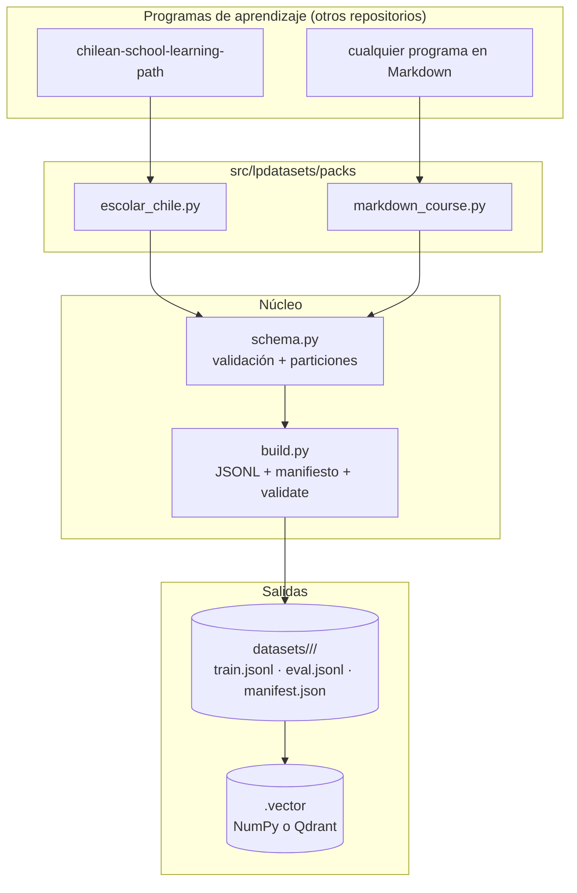

# Arquitectura

El repositorio separa tres responsabilidades y las comunica por un contrato de datos, no por código compartido.

## Piezas

| Pieza | Archivo | Responsabilidad |
|---|---|---|
| Esquema | `schema.py` | define los campos, valida registros y asigna la partición |
| Packs | `packs/*.py` | un adaptador por programa; lee la fuente y emite registros del esquema |
| Construcción | `build.py` | ordena, valida, escribe JSONL y manifiesto; `validate_datasets` comprueba todo lo publicado |
| Vector | `vector.py` | embedder, almacén NumPy exacto y almacén Qdrant local |
| CLI | `cli.py` | `export`, `validate`, `stats`, `index`, `search` |

## Decisiones

1. **Contrato antes que código.** Un programa nuevo no cambia el núcleo: solo agrega un pack que cumpla el esquema.
2. **Procedencia en cada línea.** Cada registro guarda repositorio, commit y ruta de origen. Un dataset se reproduce desde un commit fijo.
3. **Salidas deterministas.** Claves ordenadas, registros ordenados por `id` y sin marcas de tiempo: la misma fuente produce los mismos bytes y los mismos SHA-256.
4. **Evaluación separada por clase.** La partición depende del pack y de la clase, no del ejemplo, para evitar fugas dentro de una clase.
5. **Una dependencia obligatoria.** El núcleo solo requiere NumPy; Qdrant es opcional.
6. **El dato publicado se valida en CI.** Las pruebas leen `datasets/` tal como está en el repositorio, no una copia generada al vuelo.

## Hacia el núcleo

El flujo de arriba es el que produce el dataset publicado. El [plan de 1.º básico](PLAN_1_BASICO.md) lo reemplaza gradualmente por un [núcleo](CORE_CONTRACT.md) del que leen todas las [modalidades](lineas/README.md). Hoy existen el contrato (`core.py`) y el registro de modalidades (`modalities.py`), todavía sin contenido exportado.

## Qué no hace

No descarga ni entrena modelos, no revisa el contenido pedagógico y no sustituye la revisión humana. No copia textos oficiales de objetivos de aprendizaje.
