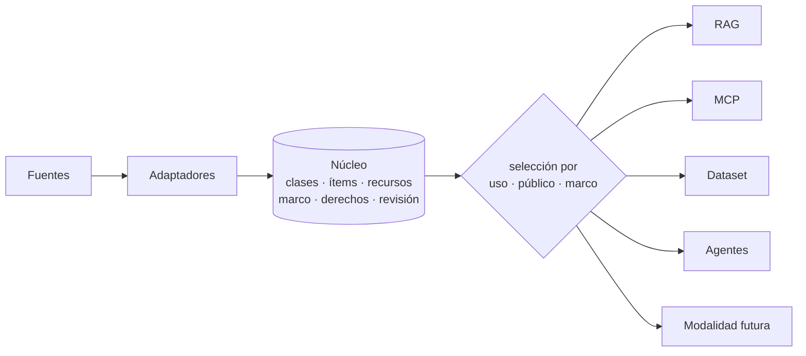

# Plan de implementación · 1.º básico

Fecha de corte: **2026-11-26**. Alcance actual: **exclusivamente 1.º básico**. Este documento es el plan; el estado real de cada línea está en [su documento](lineas/README.md).

## Objetivo

El dataset es una de las salidas, no el centro. El mismo contenido de aprendizaje debe servir para recuperación (RAG), un servidor MCP, entrenamiento y ajuste de modelos, skills y agentes, y modalidades que todavía no existen, sin rediseñar el núcleo cada vez.

## Punto de partida

Fuente: [chilean-school-learning-path](https://github.com/vladimiracunadev-create/chilean-school-learning-path). Cifras de su `curriculum/catalog.json` y del dataset publicado aquí.

| Medida | Valor |
|---|---:|
| Objetivos de aprendizaje (OA) de 1.º básico | 237 |
| Entradas de clase en el catálogo | 1.034 |
| Clases desarrolladas | 691 |
| Experiencias integradas (habilidades y actitudes dentro de otras clases) | 343 |
| Clases exportadas al dataset v1.0 | 562 |
| Clases desarrolladas excluidas (Lengua y Cultura de Pueblos Originarios) | 129 |

La exclusión se mantiene: esa asignatura requiere un educador tradicional.

## Vacíos y cómo se cubren

| Vacío | Medición | Cómo se busca o se crea | Línea |
|---|---|---|---|
| Solo hay texto | por palabras clave: 286 clases mencionan dibujar o pintar, 219 escuchar o cantar y 118 mirar imágenes | inventariar el recurso que pide cada clase; crear imágenes y audio propios o con licencia compatible | L03 |
| Estudiantes que aún no leen | explicaciones de 121 palabras en promedio | versión para lectura en voz alta y guía para el adulto | L03, L07 |
| Sin habilidades etiquetadas | `habilidades` vacío en los 16.386 registros | etiquetar desde OA e indicadores, con verificador | L03 |
| Dificultad incompleta | 8.518 registros sin `dificultad` | etiquetar con criterio declarado | L02 |
| Sin ítems de evaluación | el banco de la fuente tiene 6 ítems y ninguno es de 1.º | crear ítems propios; las evaluaciones oficiales solo como referencia | L03 |
| Guías docentes y rúbricas fuera | el dataset lee solo el cuaderno del estudiante y los diccionarios | sumarlas al núcleo | L01 |
| Lecturas | solo Lenguaje tiene lecturas asociadas, y son enlaces | catalogar derechos; escribir textos propios | L03 |
| Duplicados y cruces | 282 pares repetidos; 27 registros de evaluación idénticos a uno de entrenamiento; 203 de 1.797 comparten la entrada; 525 entradas con respuestas distintas (algunas pueden ser legítimas) | línea de limpieza | L02 |
| Sin revisión humana | todos los registros declaran `ia_asistida_sin_revision_humana` | muestreo por asignatura, registrando quién revisó | L02 |

Las mediciones sobre texto comparan en minúsculas y con espacios normalizados. Los conteos por palabras clave son heurísticos: indican dónde mirar, no cuántas clases necesitan de verdad un recurso.

## Cambios educativos y derechos

| Asunto | Hallazgo | Grado de verificación |
|---|---|---|
| Bases Curriculares 1.º a 6.º vigentes | la [página oficial](https://www.curriculumnacional.cl/recursos/bases-curriculares-1-6-basico) las clasifica como base curricular obligatoria y no menciona una versión nueva | página oficial leída |
| Posible nueva propuesta para 1.º a 6.º | [The Clinic](https://www.theclinic.cl/2026/11/25/desde-educacion-financiera-al-uso-de-ia-y-foco-en-fake-news-los-cambios-del-mineduc-para-actualizar-el-curriculum-escolar-de-1-a-6-basico/), citando a El Mercurio, informa su ingreso al CNED el 2026-11-16 | **solo resumen de buscador**; el sitio y el CNED bloquearon la lectura |
| Inglés en 1.º básico | existe como [propuesta curricular](https://www.curriculumnacional.cl/docentes/Educacion-General/Ingles-Propuesta-curricular-/Ingles-Propuesta-1-basico/18984:Propuesta-curricular-Ingles-1-basico) no obligatoria; la fuente la marca `propuesta-mineduc` | catálogo de la fuente leído; carácter no obligatorio según resumen de buscador |
| Reutilización de contenidos del Mineduc | la [política del sitio](https://www.curriculumnacional.cl/politica-privacidad) permite fines no comerciales y exige autorización escrita para el uso comercial; la página de las Bases las rotula «Dominio público» | páginas oficiales leídas; **contradicción sin resolver** |
| Evaluaciones DIA | el [monitoreo intermedio 2026](https://diagnosticointegral.agenciaeducacion.cl/documentos/Preguntas%20Frecuentes%20MI%202026.pdf) incluye Lectura y Matemática de 1.º básico | solo resumen de buscador |

Esto no es asesoría legal.

## Arquitectura

Reglas de escalamiento:

1. Cada modalidad es un módulo que **solo lee el núcleo**. Agregar una no modifica las demás.
2. Texto, imagen, audio o un medio nuevo son **recursos** con tipo MIME: no exigen cambiar el contrato.
3. El diseño no bloquea usos. Los **permisos viajan como datos** en cada entidad y la selección filtra según el uso pedido: personal, educativo o comercial.
4. El titular puede licenciar su contenido propio como decida y registrar la autorización; el texto de terceros conserva sus condiciones.
5. Cada entidad declara su **marco curricular**, para no mezclar bases vigentes con propuestas.

El contrato está en [Núcleo](CORE_CONTRACT.md).

## Líneas

| Línea | Casos principales | Listo cuando |
|---|---|---|
| [L01 Núcleo](lineas/L01-nucleo.md) | trazar clase, OA, versión y derechos | cuadra con las 1.034 entradas, con exclusiones declaradas |
| [L02 Limpieza](lineas/L02-limpieza.md) | duplicados, respuestas en conflicto, referencias a recursos ausentes | informe antes y después |
| [L03 Vacíos y creación](lineas/L03-vacios-creacion.md) | recursos, ítems, accesibilidad | cada pieza con autor, fuente y verificación |
| [L04 Vigía curricular](lineas/L04-vigia-curricular.md) | cambios de Bases, CNED, evaluaciones | informe con fecha, URL y OA afectados |
| [L05 RAG](lineas/L05-rag.md) | consulta docente, apoyo en casa, sin internet | acierto medido con consultas de referencia |
| [L06 MCP](lineas/L06-mcp.md) | buscar, ver clase, ejercicios por OA | pruebas y citas correctas |
| [L07 Agentes de uso](lineas/L07-agentes-uso.md) | tutor mediado por adulto, guías, evaluaciones, planificación | casos de prueba aprobados |
| [L08 Dataset](lineas/L08-dataset.md) | conversación, instrucción, evaluación | sin cruces entre particiones |
| [L09 Ajuste de modelos](lineas/L09-fine-tuning.md) | estilo y nivel para 6 años | comparación base, RAG y ajustado |
| [L10 Modalidad nueva](lineas/L10-modalidad-nueva.md) | cualquier salida futura | se crea desde la plantilla sin tocar el núcleo |

**Documentación obligatoria:** cada línea tiene su documento con las secciones de la [plantilla](lineas/_PLANTILLA.md). `python scripts/verify_docs.py` lo comprueba y el CI falla si falta.

## Skills y agentes por crear

| Función | Nuevo | Reutiliza |
|---|---|---|
| Crear | `investigador-fuentes`, `autor-contenido` | `extractor-conocimiento`, `verificador-independiente` |
| Limpiar | `limpiador-datos` (propone; no borra sin registro) | `curador-datasets` |
| Vigilar cambios en Chile | `vigia-curricular` | `auditor-derechos-datos` |

Flujo: vigía → informe → **aprobación humana** → autor → verificador → limpieza → publicación. El vigía distingue fuente oficial de prensa, no cambia contenido por sí solo y marca para revisión manual los sitios que bloqueen la lectura.

## Orden

| Fase | Contenido | Estado |
|---|---|---|
| 0 | plantilla de documentación, contrato del núcleo y marcos curriculares | hecha |
| 1 | L01 y L02 | pendiente |
| 2 | L04 y L03, temprano por el posible cambio curricular | pendiente |
| 3 | L05, L06 y L07 | pendiente |
| 4 | L08 y L09 | pendiente |

La prueba de escalamiento (una salida de ejemplo, como fichas imprimibles, sin tocar el núcleo) se hace cuando L01 produzca datos. En la fase 0 se probó el contrato con una modalidad ficticia dentro de las pruebas.

## Decisiones pendientes

| Decisión | Propuesta mientras no se resuelva |
|---|---|
| Público principal | docentes y adultos que acompañan, por la falta de revisión humana |
| Uso comercial | no, hasta decidirlo y revisar derechos |
| Dónde ajustar modelos | por decidir; requiere una GPU adecuada |
| Dónde publicar archivos grandes | Releases o Hugging Face, fuera de Git |

## Referencias técnicas por confirmar al implementar

- [Especificación MCP 2026-07-28](https://modelcontextprotocol.io/specification/2026-07-28).
- [`intfloat/multilingual-e5-small`](https://huggingface.co/intfloat/multilingual-e5-small) y [`BAAI/bge-m3`](https://huggingface.co/BAAI/bge-m3), ambos publicados con licencia MIT según resumen de buscador; aún no probados aquí.
