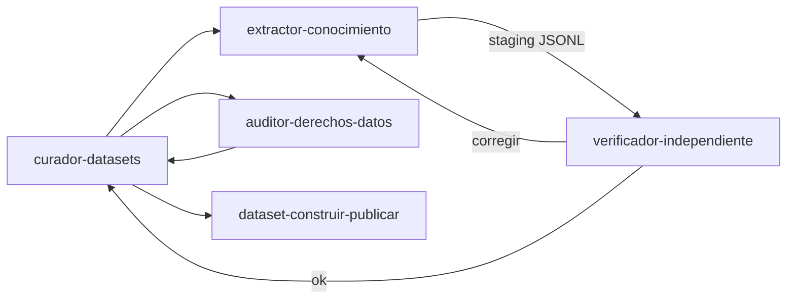

# Skills y agentes para crear datasets de conocimiento

Cuatro skills y cinco agentes de Claude Code, **independientes del dominio**, que siguen el [estándar de conocimiento puro](KNOWLEDGE_STANDARD.md). Viven en `.claude/skills/` y `.claude/agents/`, así que funcionan solos dentro de este repositorio; además se pueden instalar para todos tus proyectos.

## Skills

| Skill | Para qué sirve |
|---|---|
| `dataset-conocimiento-extraer` | convierte una unidad de cualquier fuente en registros atómicos, autocontenidos y fundamentados, con procedencia y licencia |
| `dataset-verificar` | verificación independiente: fidelidad a la fuente, corrección, ambigüedad, duplicados, fuga, sesgos, derechos y vigencia; informe con cobertura real |
| `dataset-construir-publicar` | exportar, validar, comprobar reproducibilidad, actualizar cifras y documentos, indexar y publicar con CI en verde |
| `dataset-pack-nuevo` | sumar un programa o dominio nuevo: analiza la fuente, define unidad y partición, escribe el adaptador, pruebas y tarjeta |

## Agentes

| Agente | Rol |
|---|---|
| `extractor-conocimiento` | **autor**: aplica la skill de extracción, una unidad por vez |
| `verificador-independiente` | **lector**: contexto distinto al autor; no sube el estado de revisión |
| `curador-datasets` | **orquesta** el ciclo (máximo dos tareas en paralelo), integra, deduplica y publica |
| `auditor-derechos-datos` | licencias, texto de terceros, datos personales y contenido que exige un experto |
| `limpiador-datos` | convierte los hallazgos de limpieza en propuestas; registra solo lo que una persona apruebe |

Además, un agente **propio del contenido escolar chileno**:

| Agente | Rol |
|---|---|
| `vigia-curricular` | ejecuta el vigía, explica qué cambió y qué debe revisar una persona; no cambia contenido ([L04](lineas/L04-vigia-curricular.md)) |

## Revisar y corregir contenidos

Generales: sirven para cualquier materia y nivel, no solo para datasets.

| Pieza | Rol |
|---|---|
| skill `contenido-revisar` | el procedimiento, con su [prompt maestro](../.claude/skills/contenido-revisar/prompt-maestro.md), un [catálogo de defectos](../.claude/skills/contenido-revisar/catalogo-defectos.md) y un [perfil](../.claude/skills/contenido-revisar/perfil-trayectoria-escolar-chile.md) del repositorio escolar como ejemplo |
| agente `auditor-contenidos` | entiende el repositorio y busca defectos; no edita |
| agente `corrector-contenidos` | redacta correcciones y aplica solo las aprobadas y autorizadas |

Verifica `verificador-independiente`, en un contexto distinto al del corrector.

## Ciclo recomendado



La separación autor / lector es la regla central: **quien verifica no es quien escribió**, y ninguno marca revisión humana.

## Instalar en todos tus proyectos

```bash
python scripts/install_claude_assets.py --dry-run      # ver qué haría
python scripts/install_claude_assets.py                # copia a ~/.claude/skills y ~/.claude/agents
```

No sobrescribe una copia distinta sin `--force` (que deja un `.bak`). Las skills enlazan sus documentos de apoyo por URL, así que funcionan también fuera de este repositorio.

## Comprobación

`python scripts/verify_assets.py` valida el frontmatter, los nombres, la longitud de las descripciones y que los enlaces apunten a documentos que existen; las pruebas lo ejecutan en cada CI.

## Límites

Son instrucciones para un asistente, no software que garantice calidad: la verificación sigue dependiendo de que el verificador de verdad contraste con la fuente. Se probaron la estructura y los enlaces, no la calidad de lo que producen en un dominio concreto.
